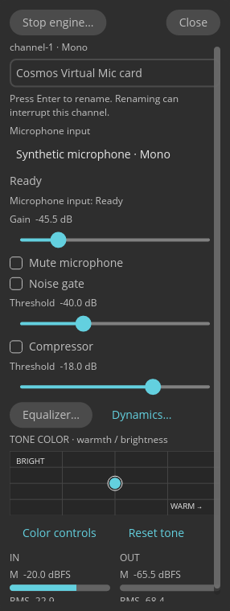

# Cosmos Virtual Mic

A small native Linux app that turns one microphone into a processed virtual microphone. Select your input, adjust its sound, then select **Cosmos Virtual Mic** in your recording, meeting, or streaming app.



The screenshot shows the actual app with synthetic audio. It does not show a live microphone capture.

## Features

- One selected microphone and one virtual microphone, with explicit mono or stereo support.
- Live gain, mute, noise gate, compressor, parametric EQ, limiter, and tone controls.
- Input and output meters, saved settings, and a system-visible virtual microphone name.
- A separate background engine. Closing the window saves settings and leaves the engine running.
- A systemd **user** service. Start and stop the engine from the window; login startup is opt-in.

The app does not change your default audio devices, hardware names, or sound-card profiles. If the selected microphone is unavailable, it reports the fault and uses silence. It does not select another microphone or send unprocessed audio as a fallback.

## Requirements

Release binaries target **Linux x86_64**, with **glibc 2.44 or later**. They use Wayland, PipeWire with native LV2 filter hosting, LSP LV2 plugins, and a systemd user manager. They do not require the COSMIC desktop or a tray extension.

The build baseline is Fedora 45. The DEB requires a system with the same or newer library ABI, such as Ubuntu 26.10 or a suitable Debian installation. It is **not** a package for stock Ubuntu 24.04 or 26.04. A DEB file does not make these binaries compatible with older libraries. Native distribution packages install their declared dependencies; the per-user installer does not install system packages.

On Fedora 45, install the runtime packages before a per-user installation:

```sh
sudo dnf install pipewire pipewire-libs pipewire-module-filter-chain-lv2 \
  lsp-plugins-lv2 libxkbcommon libwayland-client libwayland-cursor libwayland-egl mesa-libEGL
```

You also need Bash, curl, GNU tar, coreutils, and util-linux for the per-user installer. Run it from your desktop session, **without sudo**.

## Install for your user

```sh
curl -fsSL https://github.com/petterssonjonas/cosmos-virtual-mic/releases/latest/download/install-release.sh | bash
```

This command downloads and runs code from this project's GitHub Release. To inspect the script first:

```sh
curl -fsSLO https://github.com/petterssonjonas/cosmos-virtual-mic/releases/latest/download/install-release.sh
less install-release.sh
bash install-release.sh
```

To install a specific release:

```sh
curl -fsSL https://github.com/petterssonjonas/cosmos-virtual-mic/releases/download/v0.2/install-release.sh \
  | bash -s -- --version v0.2
```

The script verifies the downloaded archive against that release's SHA-256 manifest before it runs the bundle installer. Checksums detect damaged downloads; they are not an independent signature if the release account is compromised.

The installer puts both executables in `~/.local/bin`, adds the app launcher and icon, and installs `cosmos-virtual-mic.service` under `${XDG_CONFIG_HOME:-~/.config}/systemd/user`. It checks that both executables can run before it replaces an existing installation. Updates save and stop the matching engine first. Saved microphone settings and unrelated files remain in place.

A fresh install does **not** enable login startup. To enable it explicitly:

```sh
curl -fsSL https://github.com/petterssonjonas/cosmos-virtual-mic/releases/latest/download/install-release.sh \
  | bash -s -- --enable
```

Launch **Cosmos Virtual Mic** from your app menu, or run:

```sh
~/.local/bin/cosmos-virtual-mic
```

Add `~/.local/bin` to your `PATH` if you want to run the command by name. The installer does not change your shell configuration.

### RPM, DEB, or tarball

Download an asset and `SHA256SUMS` from [Releases](https://github.com/petterssonjonas/cosmos-virtual-mic/releases). Verify the downloaded asset against its entry in `SHA256SUMS` before installation.

```sh
# Fedora: use the RPM instead of the per-user installation.
sudo dnf install ./cosmos-virtual-mic-0.2.0-1.x86_64.rpm

# A compatible Debian/Ubuntu system: use the DEB instead.
sudo apt install ./cosmos-virtual-mic_0.2.0_amd64.deb

# Or extract the binary bundle and run its per-user installer.
mkdir cosmos-virtual-mic-0.2.0
tar -xzf cosmos-virtual-mic-0.2.0-linux-x86_64.tar.gz -C cosmos-virtual-mic-0.2.0
bash cosmos-virtual-mic-0.2.0/install.sh install
```

The RPM and DEB install executables system-wide in `/usr/bin`, plus a systemd user unit, launcher, icon, and licence notices. They do not start the engine or enable login startup. Do not combine a native package with a per-user installation: both provide the same service name. Remove the old installation before changing installation methods.

## Use the app

1. Open the window and select **Start engine**.
2. Select your microphone under **Microphone input**. No microphone is selected automatically.
3. Set gain and effects. Keep the output below clipping.
4. Select the virtual microphone in the app that records your voice.
5. Use **Close** to save and close only the window. Use **Stop engine** to save and stop audio processing.

Settings are stored in `${XDG_CONFIG_HOME:-~/.config}/cosmos-virtual-mic/profile.json`. The engine and frontend must come from the same release. Old multi-channel mixer profiles are not imported or truncated.

## Service control

These commands affect only your Cosmos Virtual Mic user service, not PipeWire or other audio services:

```sh
systemctl --user status cosmos-virtual-mic.service
journalctl --user -u cosmos-virtual-mic.service -f

# Explicit opt-in to start now and at login:
systemctl --user enable --now cosmos-virtual-mic.service

# Disable login startup without stopping the current engine:
systemctl --user disable cosmos-virtual-mic.service
```

Use the window's **Stop engine** control for a save-confirmed stop. A service stop signal also attempts to save, but a forced stop or the systemd timeout can lose unsaved changes. The service restarts after a failure, subject to a start limit. After you fix the cause of repeated failures, use `systemctl --user reset-failed cosmos-virtual-mic.service`.

To remove a per-user installation and keep saved settings:

```sh
bash "${XDG_DATA_HOME:-$HOME/.local/share}/cosmos-virtual-mic/install.sh" uninstall
```

For native packages, use your package manager after you stop the engine and close the window.

## Development and releases

See [DEVELOPMENT.md](DEVELOPMENT.md) for the pinned Rust toolchain, `cosmos` toolbox, native dependencies, and isolated audio checks. `development` is the continued development branch; `main` is the release branch. The previous full mixer is preserved on [`full-mixer`](https://github.com/petterssonjonas/cosmos-virtual-mic/tree/full-mixer).

Publishing a GitHub Release starts release CD. It builds the x86_64 RPM, DEB, and binary tarball, then attaches them, the download installer, and checksums to that release. Pushing a tag alone does not build distribution packages. PR validation is separate from release CD.

Original code is licensed under [MPL-2.0](LICENSE). Release packages include third-party licence notices. Cosmos Virtual Mic is an independent project, not an official System76 product.
